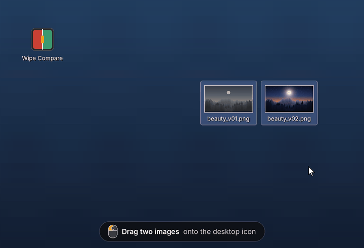

# Wipe Compare — Quick A/B Image Wipe Viewer

> **Note:** This repository serves as a visual and technical showcase of a custom desktop utility. Source code and binaries are kept private.

## UPDATING
Just replace `wipe_compare.pyw` (or the whole folder). Your shortcut keeps working.

## SETUP (once)
1. Unzip this folder somewhere permanent, e.g. `C:\Tools\WipeCompare` (keep the three files together).
2. Right-click `Wipe Compare.bat` > Show more options > Send to > Desktop (create shortcut).
3. Optional, for the nice icon: right-click the new desktop shortcut > Properties > Change Icon... > Browse > pick `wipe_compare.ico` in this folder > OK.
4. Needs Python on Windows. The first launch installs Pillow automatically (a black window may appear for a few seconds that one time).

## USE
* Select two images in Explorer and drag them onto the desktop icon.
* Or double-click the icon: it asks for the FIRST (left) and then the SECOND (right) image.
* If the sides come out the wrong way round, just press `S`.

## CONTROLS

| Control | Action |
| :--- | :--- |
| **Left-drag anywhere** | move the divider |
| **Double-click / `C`** | center the divider |
| **Scroll wheel** | zoom in/out around the cursor |
| **Middle-drag** | pan |
| **Space + drag / Alt + drag** | pan (handy on a laptop trackpad) |
| **`F`** | fit to window |
| **`1`** | 100% (actual pixels of image A) |
| **`+` / `-`** | zoom in / out |
| **`G`** | show / hide the orange grab handle (hidden by default) |
| **`H`** | hide / show the divider and labels |
| **Left / Right arrows** | nudge the divider (Shift = bigger steps) |
| **`S`** | swap left and right |
| **`O`** | open two new images |
| **`F11`** | fullscreen |
| **`Esc`** | quit (or leave fullscreen) |

The current zoom % is shown in the window title.

## NOTES
* Different resolutions are fine: both images are fitted to the window, so a 1376x768 and a 2560x1440 version line up.
* Reads PNG, JPG, TIFF (8 and 16 bit), BMP, WEBP, TGA, GIF. Not EXR.
* Display is plain sRGB, no color management or LUT.
